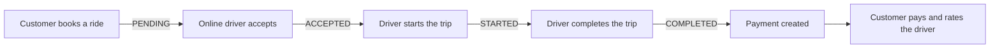

<div align="center">

# 🚕 KARATHTHE

**A taxi booking web application for Sri Lanka**

Customers book rides, drivers accept and complete trips, and admins run the whole service from one dashboard.


*Object Oriented Programming group project*

</div>

---

## Contents

- [Features](#features)
- [How a trip works](#how-a-trip-works)
- [Tech stack](#tech-stack)
- [OOP design](#oop-design)
- [Getting started](#getting-started)
- [Demo accounts](#demo-accounts)
- [Project structure](#project-structure)
- [Team](#team)
- [Contributing](#contributing)
- [Security](#security)

---

## Features

### 👤 Customer
- Register, log in and manage a profile with a photo
- Book a ride **now** or **schedule** one for later, picking pickup and drop-off on a map
- Choose a service category and vehicle type
- Follow bookings live and cancel with a reason
- Pay by card after the trip and rate the driver
- See the top-rated drivers on the home page

### 🚗 Driver
- Go online or offline
- See open ride requests, with "now" bookings first, and accept them
- See upcoming scheduled trips
- Start a trip (from 30 minutes before pickup), complete it, and record cash payments
- Manage their own vehicles

### 🛠️ Admin
- Live dashboard: waiting requests, trips on the way, drivers on a trip and payments to collect
- Manage customers, drivers and vehicles
- Record payments, including cash

---

## How a trip works



| Rule | Value |
|---|---|
| Unaccepted request expires after | 30 minutes |
| Driver can start a trip | up to 30 minutes before pickup |
| Pickup times for one driver must be apart by at least | 90 minutes |
| Scheduled bookings per customer | 5 at most |
| "Now" bookings per customer | 1 at a time |

---

## Tech stack

| Layer | Technology |
|---|---|
| Language | Java 17 |
| Framework | Spring Boot 4.1 (Spring MVC, Spring Data JPA, Validation, Scheduling) |
| Views | Thymeleaf, HTML, CSS, JavaScript |
| Database | MySQL (development), Supabase PostgreSQL (cloud), H2 (demo and tests) |
| ORM | Hibernate / JPA |
| Build | Maven (wrapper included) |
| Tests | JUnit 5, Spring Boot Test |

---

## OOP design

The project follows a layered **Model → Repository → Service → Controller** structure, and each layer has its own job.

| Concept | Where it is used |
|---|---|
| **Inheritance** | `User` → `Customer`, `Driver`, `Admin` (JPA *JOINED* tables) · `Vehicle` → `Car`, `Bike`, `Van`, `ThreeWheel`, `LuxuryCar`, `LuxuryVan`, `ServiceVehicle` · `Ride` → `NormalRide`, `PremiumRide` |
| **Abstraction** | `Vehicle` is an abstract class that every vehicle type extends |
| **Polymorphism** | `calculateFare()` is overridden in `NormalRide` and `PremiumRide`, so each ride type prices itself |
| **Encapsulation** | Private fields with getters and setters; business rules are kept inside services (`BookingService`, `TripService`, `AccountRules`) |
| **Enums** | `BookingStatus`, `RideStatus`, `DriverStatus`, `PaymentMethod`, `PaymentStatus`, `Role`, `VehicleType` |

---

## Getting started

### Requirements
- **JDK 17** or newer
- **IntelliJ IDEA** (recommended)
- MySQL 8 is optional, because the demo mode needs no database

### 1. Clone

```bash
git clone https://github.com/<your-username>/KARATHTHE.git
cd KARATHTHE
```

Or in IntelliJ: **VCS → Get from Version Control** → paste the URL → **Clone**.

### 2. Run

#### Option A: Demo mode, no database needed

```bash
mvnw spring-boot:run -Dspring-boot.run.profiles=demo
```

This uses an in-memory database with sample data, which is erased when the app stops.
In IntelliJ, set **Run → Edit Configurations → Active profiles** to `demo`.

#### Option B: MySQL

```sql
CREATE DATABASE taxi_booking_system;
```

1. Copy `application-local.properties.example` to `application-local.properties`, next to `pom.xml`.
2. Fill in `DB_PASSWORD` and `ADMIN_PASSWORD`.
3. Run:
   ```bash
   mvnw spring-boot:run
   ```

Tables are created automatically on first start.

#### Option C: Supabase (cloud PostgreSQL)

In `application-local.properties`, remove the `#` from the Supabase lines and fill in your own connection details:

```properties
spring.profiles.active=supabase
SUPABASE_DB_URL=jdbc:postgresql://aws-0-REGION.pooler.supabase.com:5432/postgres?sslmode=require
SUPABASE_DB_USER=postgres.YOUR-PROJECT-REF
SUPABASE_DB_PASSWORD=your-password
```

### 3. Open

👉 **http://localhost:8080**

| Area | URL |
|---|---|
| Customer site | `/` |
| Driver login | `/drivers/login` |
| Admin login | `/admin/login` |

---

## Demo accounts

Available in **demo mode** only.

| Role | Email | Password |
|---|---|---|
| Admin | `admin@karaththe.lk` | `Admin@12345` |
| Customer | `nimal@example.com` | `Demo@12345` |
| Driver (has open requests) | `kamal@example.com` | `Demo@12345` |

---

## Project structure

```
src/main/java/com/taxibooking/taxibookingsystem
├── model/        Entities: users, vehicles, bookings, rides, payments, reviews
├── repository/   Spring Data JPA repositories
├── service/      Business rules
├── controller/   Web controllers, one per area
├── security/     Roles, @RequireRole, access and CSRF checks
└── config/       Web setup, error handling, scheduled jobs, demo data

src/main/resources
├── templates/    Thymeleaf pages (customer, driver, admin, error)
├── static/       CSS, JavaScript and images
└── application*.properties
```

| Settings file | Used for |
|---|---|
| `application.properties` | Shared settings |
| `application-dev.properties` | Local MySQL (default) |
| `application-demo.properties` | In-memory database with sample data |
| `application-supabase.properties` | Supabase PostgreSQL |
| `application-prod.properties` | Deployment, values from environment variables |
| `application-local.properties` | Your own passwords, **never committed** |

---

## Team

| # | Member | Module |
|---|---|---|
| 1 | Heshan N P H | Customers and Security |
| 2 | Jeewantha H A N | Drivers |
| 3 | Sahthi M J M A | Vehicles |
| 4 | Cristika N | Bookings |
| 5 | Lawandi H M C | Rides |
| 6 | Silva H R D *(team lead)* | Payments, Reviews and Admin · Front end · Database · Integration |

---

## Contributing

1. **Pull** before you start: `Git → Pull`
2. Change **only your own module's files**. Front-end changes go through the team lead.
3. Commit with your student ID, name and module:
   ```
   IT24XXXXXX - Name - Module
   ```
4. **Pull again, then push.**

> ⚠️ Never commit `application-local.properties`, passwords, the `target/` folder or the `.idea/` folder.

---

## Security

- Passwords are stored as **BCrypt** hashes
- Role-based access with `@RequireRole`, enforced by `AccessInterceptor`
- **CSRF** token check on every POST request
- Users can only act on their own bookings, rides, payments and reviews
- Login is blocked for 15 minutes after repeated failed attempts
- Sessions expire after 20 minutes of inactivity

---

## Tests

```bash
mvnw test
```

Tests run on an in-memory database, so MySQL does not need to be running.

---

<div align="center">

**KARATHTHE** · Built by Team KARATHTHE for the OOP module

</div>
